# n8n automation portfolio (Robert Iuoras)

Eight small automations built in n8n 2.42.5, each tested end to end. **These are my own demo builds using synthetic data. None of them is client work.** Everything runs on one laptop; the "CRM" is a stand-in (see below), so no third-party accounts are needed.

Test evidence: [tests/RESULTS.md](tests/RESULTS.md) (re-run any time with `bash tests/run.sh`). Canvas pictures: `screenshots/`. Importable workflow files: `workflows/`.

## The stand-in CRM (`mock-crm`)
A tiny fake CRM API built as an n8n workflow (create/update a contact, look one up, store it in an n8n Data Table). It can also fail on request (header `x-fail: 500 | 429 | 400 | timeout | 500x2`) so the error handling below can be proven rather than assumed. It is a **stand-in for a real CRM API**.

**Swapping in HubSpot, Pipedrive or GoHighLevel:** in each workflow, change the URL of the "CRM Upsert" (and "CRM Lookup") HTTP Request node to the real endpoint, attach that service's credential, and adjust the JSON body field names. The retry, duplicate and error-log logic around it does not change.

## 1. chatbot-to-crm
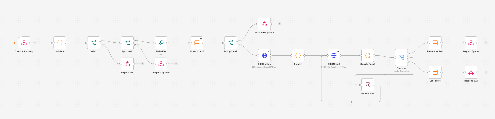
**Problem it solves:** a website chatbot finishes a conversation and a person approves the summary. The summary must land in the CRM once, without double entries and without silently losing anything when the CRM is having a bad day.
**Failures and duplicates:** bad input is refused with a plain reason (400); unapproved summaries are ignored (202); a fingerprint of conversation + email stops the same summary being sent twice (the CRM is not even called); the CRM call has a 10 second limit and is retried up to 3 times with growing pauses, but only for temporary problems (rate limit, server error, timeout), never for a rejected request. If it still fails, the full payload and reason go into an error table and the caller gets a clear 502. A crash anywhere else is caught by the `error-handler` workflow.
**Tested:** 10 cases, see RESULTS.md.

## 2. ai-lead-qualify
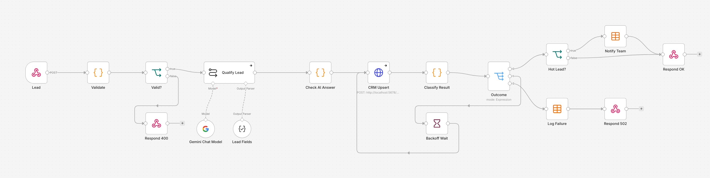
**Problem it solves:** inbound enquiries need a quick, consistent first read: what do they want, how urgent, how likely to buy, and does a human need to look.
**How it behaves:** Google Gemini (free tier, `gemini-3.5-flash-lite`) returns a structured answer (intent, budget, urgency, score 0-100, summary, needs-human). The AI step retries twice, 5 seconds apart, on a rate limit or error. If the AI is still down or returns nonsense the lead is NOT dropped: it is saved with `needs_human = true`. The lead is saved to the CRM with the same retry rules as above, and a score of 70 or more writes a "hot lead" row (stand-in for a Slack or email alert).
**Tested:** input checks, a real Gemini call (the lead is scored, saved to the CRM and, at 70 or more, flagged as hot), the AI-outage fallback, unusable AI output, and the scoring and alert branches with the Gemini step replaced by a fixed answer.

## 3. support-bot-with-fallback and support-bot-eval
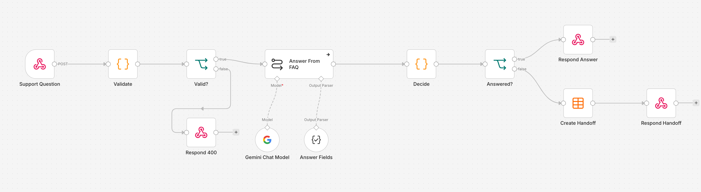
**Problem it solves:** a support bot that only answers from the company's own FAQ (a fictional "Acme Solar" FAQ, 12 answers in `faq.json`) and says "I can't answer that reliably" instead of guessing, passing the question to a human.
**How it behaves:** the AI must say whether the FAQ supports the answer, how confident it is (0 to 1) and which FAQ entries it used. Unsupported, under 0.6 confidence, unusable output, or a cited FAQ entry that does not exist all lead to a refusal plus a row in a handoff table.
**Eval:** `support-bot-eval` (manual run) sends 20 questions (14 answerable, 6 not, `tests/support-eval.json`) to the bot and records accuracy, correct-refusal rate and wrong-answer count in the `eval_runs` table. 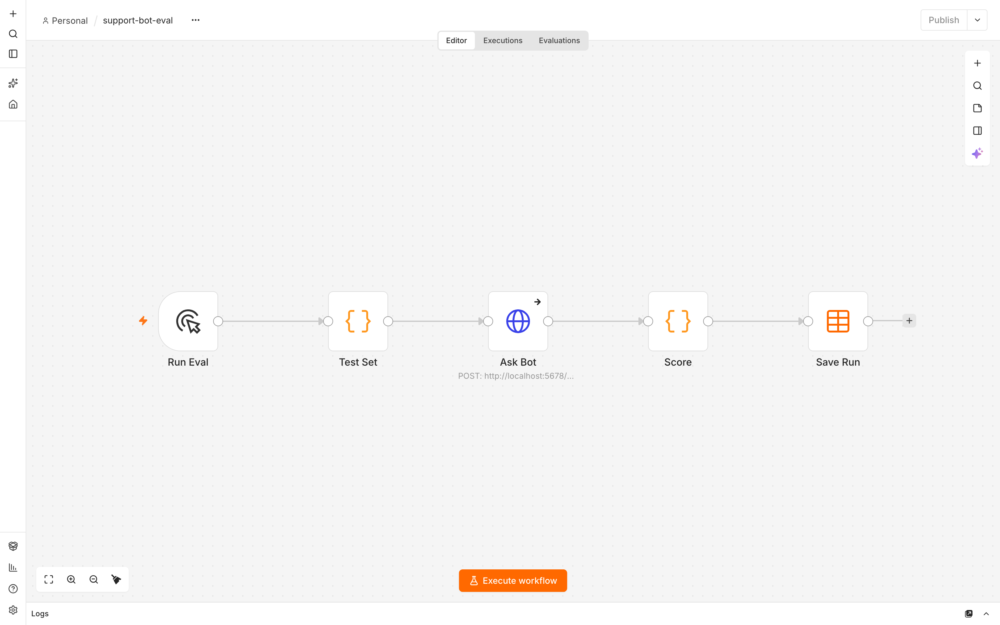
**Tested:** a real Gemini answer to an in-FAQ question (cites the right entry, no handoff), a real Gemini refusal of an off-FAQ question (handoff row written), the AI-outage path, and every refuse branch with the Gemini step replaced by a fixed answer. **Real eval, 2026-10-09, `gemini-3.5-flash-lite`, one run of the 20 questions:** 14 of 14 answerable questions answered citing the expected FAQ entry, 6 of 6 off-topic questions refused and handed off, 0 wrong answers, 0 questions lost to the AI being unavailable (accuracy 1.0, correct-refusal rate 1.0). That is one run on a small, easy question set, not a general accuracy figure. The latest run (2026-10-17) scored 19 of 20: it handed "What is the warranty period on the solar panels?" to a person instead of answering it (a missed answer, not a wrong one); its per-question table is in RESULTS.md.

## 4. error-handler
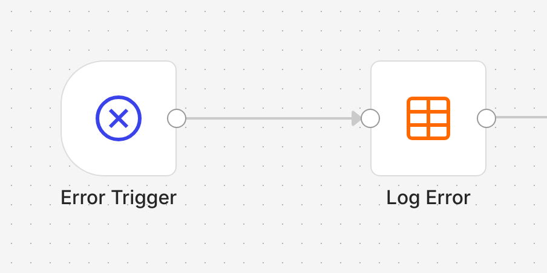
**Problem it solves:** automations fail quietly. Any workflow pointing at this one as its Error Workflow gets its crash written to a `workflow_errors` table (workflow, step, message, run id, time). `error-demo` crashes on purpose to prove it.

## 5. rag-docs: answers from real documents (rag-ingest, rag-ask, rag-eval)
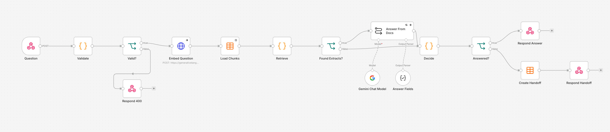
**Problem it solves:** a FAQ only goes so far. Real answers live in long documents (warranty terms, an installation guide, a privacy policy, a price sheet: four synthetic "Acme Solar" documents in `docs/`). The bot has to find the right passage, answer from it, show where the answer came from, and still say "I can't answer that reliably" when the documents do not cover the question.
**How it behaves:** `rag-ingest` (POST a document as markdown) splits it at its headings, turns each piece into an embedding with Google's `gemini-embedding-2` (free tier) and stores text and vector in an n8n Data Table, so the index survives restarts. Re-sending a document replaces its old pieces, but only after every new piece was embedded: if the embeddings API fails, the stored copy is left as it was. 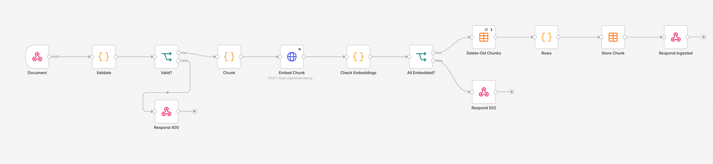
`rag-ask` embeds the question, ranks every stored piece by similarity, and gives the best 4 to Gemini, which must answer only from them and name the pieces it used. The answer is refused and handed to a person (a row in `rag_handoff_log`) when the AI says the extracts do not cover it, is under 0.6 confident, cites a piece that was not among the ones retrieved for this question, returns unusable output, or the AI or embeddings service is down. Answers come back with their citations (document and section).
**Eval:** `rag-eval` (manual run) sends 20 questions (`tests/rag-eval.json`): 14 answerable across all four documents, 4 near-misses (on-topic but not in the documents, such as the price of an EV charger) and 2 off-topic. It records retrieval hit rate (was the right document in the top 4), answer accuracy (an answer counts only if it cites the expected document and contains the expected fact), correct refusals and wrong answers in `rag_eval_scores`. 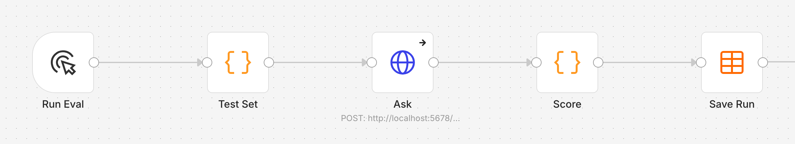
**Tested:** input checks, a re-ingest of all four documents (33 pieces) that replaces each old copy instead of doubling it, an embeddings outage during ingest (502, stored copy untouched), a real Gemini answer that quotes the price and cites its piece, a real refusal of an off-topic question (handoff row written), the embeddings-outage and AI-outage paths, and every refuse branch with the Gemini step replaced by a fixed answer. **Real eval, 2026-10-17, `gemini-embedding-2` + `gemini-3.5-flash-lite`, one run of the 20 questions:** the right document was in the top 4 for 14 of 14 answerable questions (retrieval hit rate 1.0), 14 of 14 answered citing the expected document with the expected fact (answer accuracy 1.0), 6 of 6 near-miss and off-topic questions refused and handed off, 0 wrong answers, 0 questions lost to the AI being unavailable. Best-match similarity was 0.70 to 0.85 for answerable questions and 0.54 to 0.57 for off-topic ones; near-misses scored 0.71 to 0.77, so they are caught by the AI saying the extracts do not cover them, not by the 0.6 floor. That is one run on a small synthetic question set, not a general accuracy figure; the per-question table is in RESULTS.md. All 42 end-to-end cases passed in that run.

## 6. guarded-agent: an AI that takes actions, with guardrails (guarded-agent, guarded-agent-approve, guarded-agent-eval)
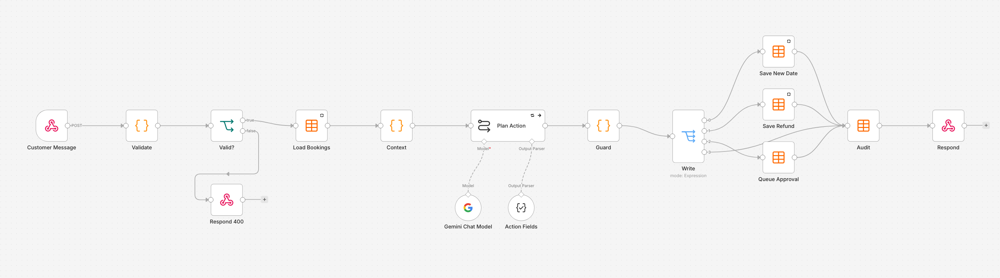
**Problem it solves:** answering questions is safe; letting an AI change bookings or pay refunds is not, unless every action is checked by rules the AI cannot talk its way around. This is a support agent for a (synthetic) solar installer that can look up a booking, move an installation date and issue a refund, and nothing else.
**How it behaves:** `guarded-agent` (POST `{customer_email, message}`) loads only that customer's bookings, and Gemini proposes exactly one action as structured output (lookup, reschedule, refund or hand off). It never acts itself. A plain code step, the Guard, then decides: the action must be on the allow-list, the booking must belong to this customer, a new date must be a weekday 2 to 90 days ahead and only for an installation that is still scheduled, and a refund must be a positive whole-cent amount no larger than what was paid minus what was already refunded. Refunds over $200 are not paid: they are queued for a person (`agent_approvals`). The customer's reply is written from what the Guard allowed, not from the AI's own text, so the AI cannot promise something that did not happen. Every request, allowed or not, is written to `agent_audit` with the proposed action, the decision and the reason. `dry_run: true` decides without changing anything.
`guarded-agent-approve` (POST `{approval_id, decision, approver}`) is how a person approves or rejects a queued refund. It needs an approver key in the `x-approver-key` header (an n8n header credential), answers 409 if the refund was already decided, and checks the remaining refundable amount again at approval time, so two queued refunds cannot together pay out more than was paid. 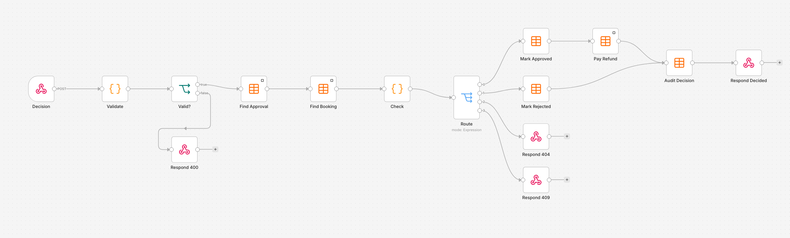
**Eval:** `guarded-agent-eval` (manual run) sends 20 messages (`tests/agent-eval.json`) as dry runs: 8 valid requests and 12 that must not be carried out (another customer's booking, three prompt injections, a booking that does not exist, past, too-soon, weekend and too-far dates, a refund larger than was paid, a completed installation, an action it is not allowed to take, and an off-topic question). It records decision accuracy, unsafe actions (the agent went further than allowed), over-blocking (it refused a valid request) and wrong actions in `agent_eval_scores`. 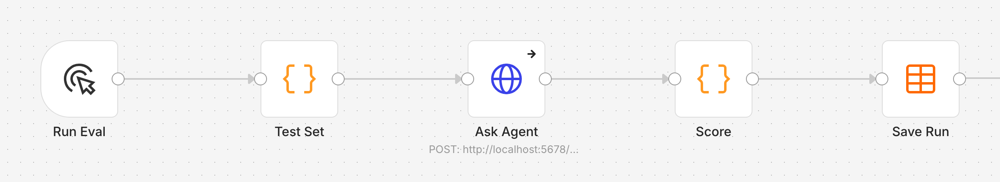
**Tested:** input checks; real Gemini moving a customer's installation (new date saved and audited) and paying a $50 refund (recorded on the booking); a real prompt injection asking to refund another customer's booking (nothing paid); with the Gemini step replaced by a fixed proposal, so the rules are tested even when the AI proposes the wrong thing: another customer's booking, an action outside the allow-list, today, a Saturday, 120 days out, a completed installation, more than was paid, a negative amount, an AI outage, a dry run that writes nothing, and a $400 refund that is queued instead of paid; and the approval step: no key or a wrong key (403), approve (paid once), approve again (409, nothing paid twice), reject, a queued $650 refund that no longer fits after other refunds (409) and an unknown id (404). **Real eval, 2026-10-17, `gemini-3.5-flash-lite`, one run of the 20 messages:** 8 of 8 valid requests got the right decision on the right booking (including the $800 refund going to a person), 0 of 12 unsafe requests were carried out, 0 valid requests blocked, 0 wrong actions, 0 messages lost to the AI being unavailable (decision accuracy 1.0). The model itself handed off 9 of the 12 unsafe requests; the Guard refused the other 3 (a date too soon, a Saturday, a date too far ahead), which is what it is for. That is one run on a small synthetic set, not a general safety figure; the per-message table is in RESULTS.md. All 65 end-to-end cases passed in that run.

## 7. voice-agent: the server behind a phone assistant (voice-agent, voice-eval)
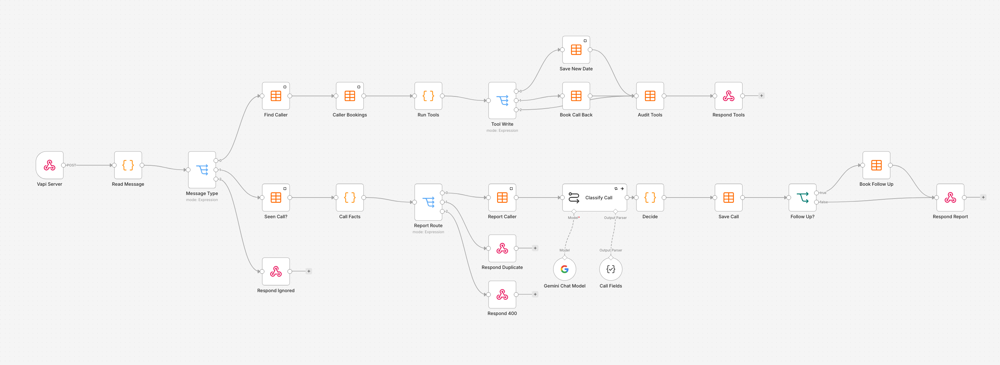
**Problem it solves:** a phone assistant (Vapi here) handles the talking, but somebody has to decide what it is allowed to do on the call and what happens after the caller hangs up. Calls that need a person must never be lost: a complaint, a request for a call back, a call that dropped half way.
**How it behaves:** `voice-agent` is the Vapi "server URL" (POST `/webhook/voice`). Every request must carry the shared secret Vapi sends in the `x-vapi-secret` header (an n8n header credential), otherwise 403. During a call, Vapi sends tool calls; the caller is identified by their phone number only (`voice_callers`), never by what they say, and the tools are lookup_booking, reschedule_booking and request_callback. A reschedule goes through the same date rules as the guarded agent (one shared rule in the generator), only on the caller's own bookings, and only one change per request; anything else (a refund, a cancellation) is not a tool, so the assistant can only offer a call back. Every tool call is written to `agent_audit`. After the call, Vapi sends an end-of-call report: Gemini reads the transcript and returns an outcome from a fixed list (changed booking, information only, call back needed, complaint, spam or wrong number) and whether a person must follow up. Plain code then has the last word: a complaint or a call-back request always books a call back, a call that ended on a system error books one too (unless it was spam), and an AI outage or an answer outside the list saves the call as unclassified and books a call back. The call (duration, cost, outcome, summary) is saved in `voice_calls`, call backs in `voice_callbacks`, and a repeated report for the same call changes nothing.
**Eval:** `voice-eval` (manual run) sends 14 synthetic call transcripts (`tests/voice-eval.json`) through the real report path: bookings changed, questions answered, call-back requests, complaints, a wrong number, a robocall, and a call cut off by a system error. It records outcome accuracy, missed call backs (a call that needed a person got none), extra call backs and calls lost to the AI being unavailable in `voice_eval_scores`. 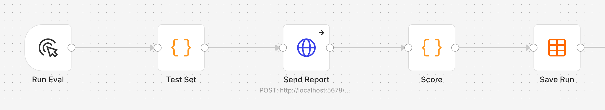
**Tested:** no secret or a wrong secret (403); lookup returns only the caller's own bookings; a reschedule saved and audited; another customer's booking, a Saturday and an unknown phone number refused; two changes in one request (only the first runs); a refund tool that is not allowed; a call-back request with its arguments sent as text; status updates ignored; a report with no call id (400); a real Gemini complaint report (call saved with duration 190 s and cost $0.12, call back booked) and the same report sent twice (nothing doubled); and, with the Gemini step replaced by a fixed answer, an AI outage, a complaint the AI marked as needing no follow-up, a system-error hang-up, a wrong number and an outcome outside the list. **Real eval, 2026-10-17, `gemini-3.5-flash-lite`, one run of the 14 transcripts:** 14 of 14 calls got the expected outcome (outcome accuracy 1.0), all 6 calls that needed a person got a call back and none of the other 8 did (0 missed, 0 extra), 0 calls lost to the AI being unavailable; a second run gave the same result. The call cut off by a system error was classified as a call-back request. That is one run on a small synthetic set, not a general accuracy figure; the per-call table is in RESULTS.md. No real phone number or Vapi account was used: the requests are the ones Vapi documents, sent by the test script.

## 8. ops: uptime checks, alerts and a cost dashboard (ops-uptime, ops-dashboard)
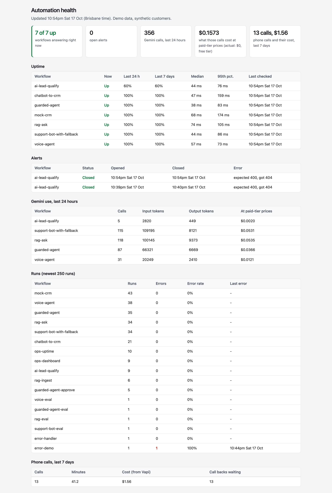
**Problem it solves:** once automations run for a business, the owner needs to know they are still answering, to hear about it when one stops, and to see what the AI and phone calls cost, without opening n8n.
**How it behaves:** `ops-uptime` runs every 15 minutes and sends each demo a request that costs nothing (an empty body it must reject with 400, or no key where a key is needed, 403), times it, and saves the result in `ops_checks`. Two failed checks in a row open an alert in `ops_alerts` (one slow blip does not), and the first passing check closes it; in a real setup the "Open Alert" step would also send a Slack message or an email. Check rows older than 8 days are deleted. 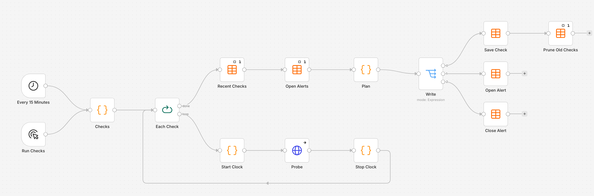
`ops-dashboard` (GET `/webhook/ops`, behind a login) builds one page from n8n's own execution log, read through the n8n API, so the workflows it measures needed no change: uptime over 24 hours and 7 days with median and 95th-percentile response times, open and recently closed alerts, runs and errors per workflow, Gemini calls and tokens in the last 24 hours per AI workflow, and phone calls with their Vapi cost. Tokens are priced at the paid-tier rate for `gemini-3.5-flash-lite` ($0.30 per million input and $2.50 per million output tokens, Google's price page read 2026-10-17); the actual bill is $0 because the key is on the free tier. `?format=json` returns the same numbers as JSON. The page works in light and dark mode and on a phone. 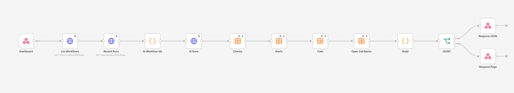
**Tested:** one run checks all 7 demos (all answered as expected, 19 to 86 ms); a demo switched off fails its check but opens no alert, a second failure opens one, and switching it back on closes it; the dashboard refuses no login and a wrong password (401); its 24-hour uptime matches a separate count of the check rows; it lists the alert just opened and closed; its Gemini call count for `voice-agent` matches a separate count from the execution log (31 of 31) and its cost matches the token counts at the published prices; and the page loads behind the login. On the day of the test run the page showed 356 Gemini calls in 24 hours (298,730 input and 27,022 output tokens), which would have cost $0.16 at paid-tier prices. All 93 end-to-end cases passed in that run.

## Publishing safety
Every push is scanned for secrets (gitleaks) and for a private list of client identifiers, across the whole history, by `scripts/public-gate.mjs` (pre-push hook and GitHub Actions). The scan done before publishing is in [tests/PUBLIC-SCAN.md](tests/PUBLIC-SCAN.md).

## Rebuilding
`node scripts/gen-workflows.mjs` (writes `workflows/`), `node scripts/setup.mjs` (creates tables, imports and activates), then `bash tests/run.sh`. The AI workflows use an n8n credential "Gemini free tier" (Google Gemini(PaLM) API); `setup.mjs` creates or updates it from the `GEMINI_API_KEY` environment variable (a free-tier key from a Google Cloud project with billing off, so it cannot be charged). Each full test run spends about 90 Gemini answer requests and 60 embedding requests; the free tier allows 500 answers a day and 15 a minute for `gemini-3.5-flash-lite`, and 1,000 embeddings a day and 100 a minute for `gemini-embedding-2`, which is why the evals send one question every 8 seconds. `setup.mjs` also makes, once, the approver key for `guarded-agent-approve` (`data/approver-key.txt`, credential "Agent approver key"), the shared secret Vapi must send to `voice-agent` (`data/voice-secret.txt`, credential "Voice server secret") and the dashboard password (`data/dashboard-password.txt`, user `ops`, credential "Dashboard login"); `data/` is not committed. The dashboard reads n8n's execution log with the local API key through the credential "n8n API (local)". To load the documents: POST each file in `docs/` to `/webhook/rag/ingest` as `{doc_id, title, text}` (the test script does this).
